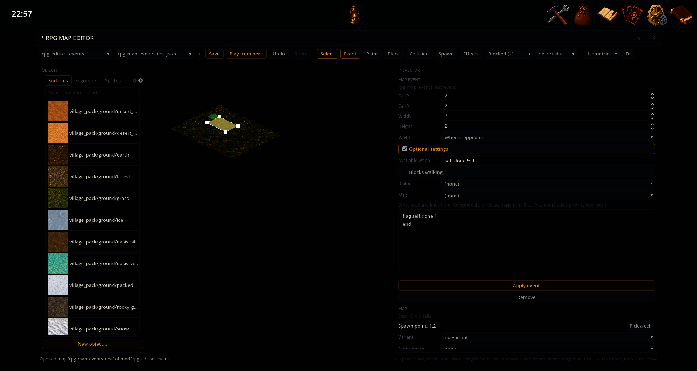
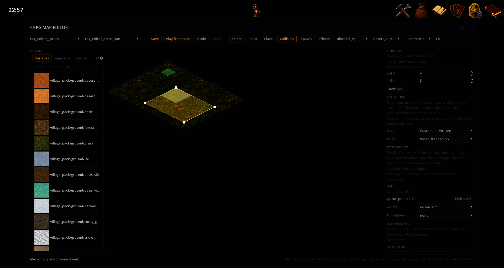
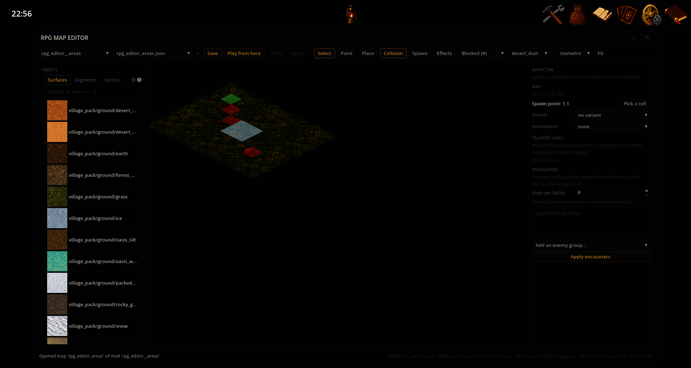
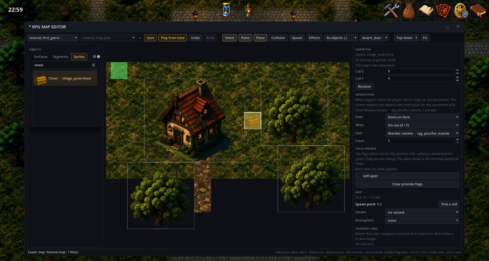
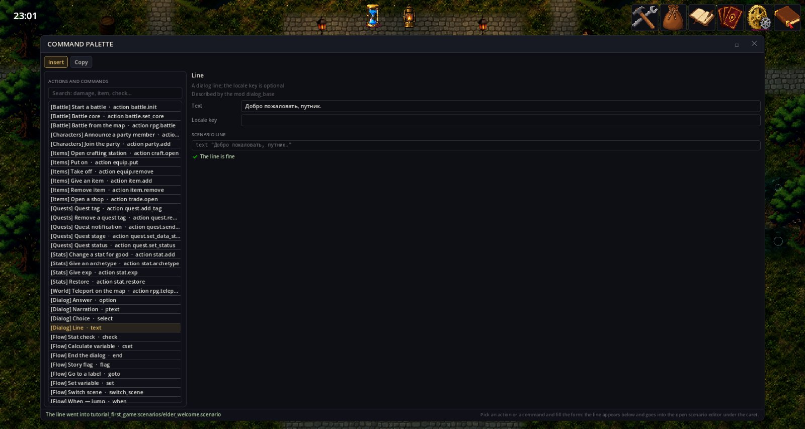
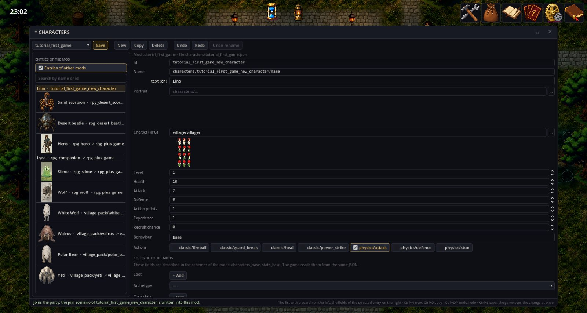
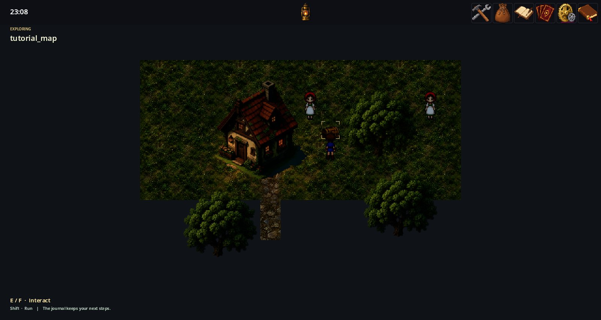
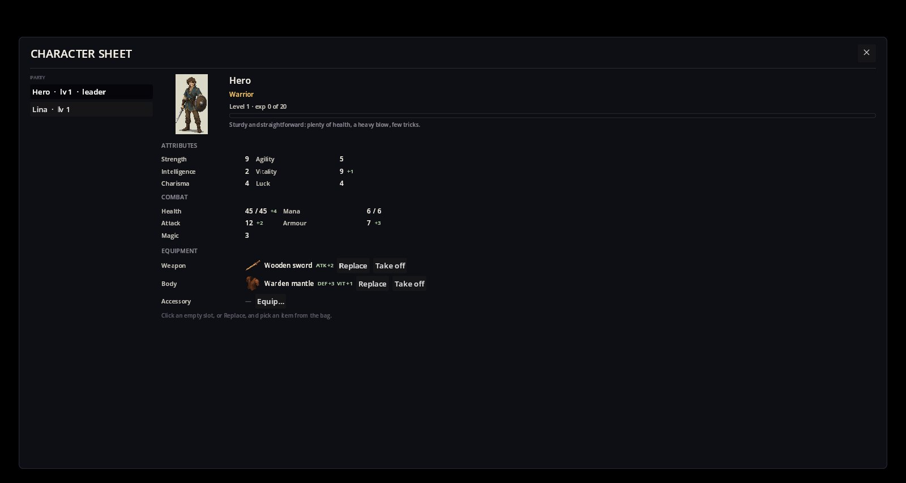
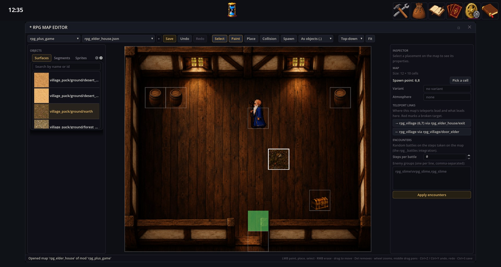
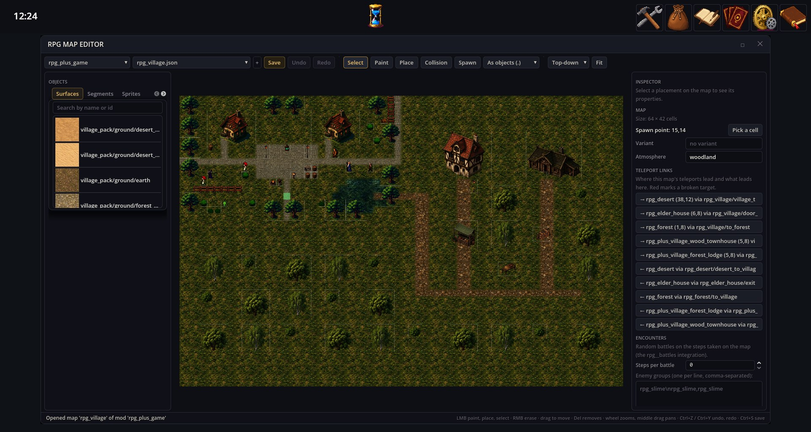

# RPG Map Editor — painting maps and placing objects

The RPG Map Editor changes the tile maps of the RPG world while the game runs. You paint the ground and the walls, place sprites and characters on cells, paint the collision, move the spawn point and set the random encounters. **Save** writes the map's files, and the game walks the new map at once — no restart.

It opens from the tool box (the hammer on the toolbar) as **RPG Map Editor**. It opens on the map the game is showing; use the map picker to open another one.

## Create an event or object from the map

Press **Event** and drag a rectangle over the tiles. In the inspector, choose **When stepped on** or **On use (E / F)**, type scenario commands, press **Apply event**, then **Save**. Short scripts stay right here: no separate object or scenario file is needed.

Use Select to move the rectangle or resize its corners in either projection. Optional settings provide a condition (`self.done != 1` until completion), a shared scenario or a teleport. Finish a one-time script with `flag self.done 1`. Events have no game picture and are walkable by default.

For a visible prop or NPC, press **New object…** below the palette. Its form opens in the current map’s mod. Set the picture and interaction, save, then choose the object from the refreshed palette and place it on the map.

## Event area size and collision

With **Select**, choose a picture-less event (trigger or door). Drag one of the four white corner squares to resize its area on the cell grid while keeping the opposite corner fixed. The handles work in both isometric and top-down views at any zoom. Dragging inside the area still moves the placement; clicking without dragging still cycles stacked placements.

The origin and size commit together on release as one **Ctrl+Z** step. The area stays inside the map and cannot shrink below one cell. A map-owned event writes `X`, `Y`, `Width`, `Height` in the map's `Events`; a legacy picture-less placement writes its own `Footprint.Size`. Foreign data is saved as a patch in your own mod; other instances stay unchanged.

Choose **Collision** to see blocked cells in translucent red, including ground, structure, object, event and NPC footprints. Isometric cells are drawn as diamonds. **LMB** paints the selected code (**Blocked / #** by default); **RMB** forces a walkable path (**o**), including through solid terrain, objects, events or NPCs. Explicit map codes `o` and `#` override object `Solid`, `Footprint.Solid` and states; `.` delegates passage back to objects. To restore natural object collision, choose **As objects / .** and paint with LMB.

The overlay updates on press and during a stroke. Release commits the whole stroke as one undo step. **Ctrl+Z / Ctrl+Y** refresh the mask immediately. Switching tools hides the mask; edits remain in the document until saved.

## Your first game in 10 minutes

This path makes a small game with the mouse and the keyboard only. You never open a text editor or a JSON file. It uses the same windows as the rest of this page, and each step says where to click. The path is the same in the automatic test that repeats it (`tutorial_first_game`).

1. **Make the mod.** In the main menu choose **Mods & Collections**, open the **Collections** tab and choose the game **RPG Plus**. On its toolbar press **New mod**. Type a **Title** (the id is filled in for you), keep **rpg_plus_game** as the base (the game's own content is first in the list) and press **Create mod**. The mod joins the game. Close the game: a new mod takes effect at the next start.
2. **Make the map.** Choose **Play**, then **RPG Plus**, then **New game**. In the game, open the tool box (the hammer on the toolbar) and choose **RPG Map Editor**. Pick your mod in the toolbar, press **+**, type the name of the map and press **OK**. Press **Save** to write the map.
3. **Paint the ground.** In the **Surfaces** tab search for `grass`, choose it, select **Paint** and drag over the map. Search for `forest_path` and draw a path from the bottom edge towards the middle. Ctrl+Z takes a stroke back.
4. **Place the houses and trees.** In the **Sprites** tab search for `cottage` and place it with **Place** (one click per object). Then search for `oak` and place two or three trees. To remove an object, select it with **Select** and press Delete.
5. **A chest that gives an item.** In **Sprites** search for `chest` and place it. Click it with **Select**. In the inspector, under **Interaction**, **Does** → **Gives an item**, choose **Warden mantle** in the picker and leave **Count** at 1. Press **Save**. Your mod reaches `village_pack` through its base `rpg_plus_game`, so the manifest keeps its text and the status line does not say **Added dependency**. The editor adds a dependency only for a mod your mod does not reach through its base; then the status line says **Added dependency on …**. You never edit the manifest yourself.

   
6. **A door back to the village.** Press **Event** and draw a rectangle at the right edge. Open **Optional settings**, choose **rpg_village** as the target map, keep **When stepped on**, and press **Apply event**. Save, then press **Pick the cell on the map** and click the arrival cell in the village. The editor returns to your map; save the target.

   
7. **An NPC with a dialog.** Open **Scenario Editor** from the tool box and press **New scenario**. Choose your mod, type `elder_welcome` and press **Create**. Open the **Command palette** from the tool box, choose **text**, type the greeting in its field and press **Insert**: the line goes into the scenario. Delete the placeholder line `text "…"` that a new scenario starts with, and press **Save** (Ctrl+S). Back in the map, open the **Actors** tab, search for `villager`, place it, select it, and under **Interaction** choose **Does** → **Opens a dialog** with the scenario **elder_welcome** in the picker. Press **Save**.

   
8. **A companion.** Keep the map editor open. Open **Characters Editor** from the tool box and press **New**. Type **Lina** in **Name**, press the **…** button of **Charset (RPG)** and choose `village/villager`. Tick **Joins the party when talked to** and press **Save**: the **Characters** tab of the open map editor lists her at once. Open **Scenario Editor**, press **New scenario**, choose your mod, type `lina_hello` and press **Create**. Put her line in with the palette as in step 7 and press **Save**. Keep the template as it is, with its placeholder and its line `end`: the join lines run after the scenario's end, so Lina says her line and then joins the party. In the map editor choose **Lina** in the **Characters** tab (the last tab) and place her next to the door. Select her, and under **Interaction**, **Does** → **Opens a dialog** with **lina_hello** in the picker. The inspector says **After the dialog this character joins the party**. Press **Save**.

   
9. **Play from here.** Click the forest path at the bottom of the map and press **Play from here** on the toolbar, next to **Save**. The game starts on your map at that cell. Walk with W, A, S and D. Stand next to the chest, face it and press E: you get the Warden mantle. Stand next to the villager, face him and press E: his dialog plays. Stand next to Lina, face her and press E: she says her line, joins the party and walks behind you. Last, step on the door: the map changes to rpg_village.

   
10. **Equip the find.** Open **Character sheet** from the game's toolbar, choose your hero in the party list and press **Equip…** in the empty **Body** slot. Choose **Warden mantle** from the bag. The hero's defence follows at once.

   

Notes on this path:

- **Play from here** works only while an RPG game is running. Open the editor from the game's tool box, as step 2 says.
- The door's target cell is chosen on the other map, so save your map before you press **Pick the cell on the map**.

## What you see

- **Toolbar** — the mod and the map file (**+** makes a new map), **Save**, **Undo**, **Redo**, the seven tools, the collision code picker, the projection picker (**Top-down** or **Isometric**) and **Fit**, which shows the whole map.
- **Palette** (left) — four object-form tabs: **Surfaces**, **Segments**, **Sprites**, **Actors**, plus **Characters** for character definitions with a `Charset`. Each tab supports search and thumbnails.
- **Map** (middle) — the map drawn by the game's own renderer. Thin frames show the footprint of each placement; the selected one is filled.
- **Inspector** (right) — the selected placement, the map's properties, its teleport links and the encounters.

The projection picker switches the drawing only. The map is the same in both projections, and you can switch while you edit:

## The tools

- **Select** — click a placement to select it; drag it to another cell to move it; **Delete** removes it; **Esc** clears the selection. Drag a rectangle over empty ground to select several placements at once; **Ctrl+A** selects them all. **Ctrl+C** copies the selected placements, and **Ctrl+V** pastes them with their first placement on the cell under the pointer (the copies keep their offsets and are selected). Delete, copy and paste each work on the whole selection, and each is one step of undo. Markers are easy to pick: a picture-less placement (a trigger, a door) is a filled cell drawn over the buildings, and a press on its cell picks it before the building under it; a repeat press on the same cell takes the next placement under it, and the status line names the selected one. The arrows are handles too. A press on the arrow of a door selects the door, and a drag moves it. The arrowhead of an arrow to a cell of this map is the target: drag it to move the target cell. A blocked cell or one off the map is refused, and its ghost is red. An incoming arrow is the arrival on this map: a press selects it, the inspector names the source map and placement with a button that opens the map, and a drag moves the arrival cell. The change is written into the source placement: into its map's file, or as a patch of this mod for a placement of another mod, which this mod must reach through its dependencies. Every drag shows a ghost of where it would land before the release; nothing moves until the release, and Undo takes each change back.
- **Effects** — paint the effect mask of the atmosphere profile chosen beside the toolbar (for example fog or snow) over cells; the right mouse button erases. The masked cells are tinted and the game draws the effect only there. A profile's mask with no cells left is removed from the map. Click **Open map editor** in the Effects Editor to open this tool with its profile chosen.
- **Paint** — choose a surface or a segment in the palette, then click or drag over cells. Surfaces paint the ground, segments paint the structure layer. The right mouse button erases.
- **Place** — choose a sprite or an actor, then click a cell. A ghost of the object follows the pointer; it turns red where the object would block cells. The **Characters** tab (the last tab) places a character as its actor object: the object is written into the map's mod (`objects/characters.json`) when the character is chosen, and a character with a join scenario (see the Characters Editor) joins the party when talked to.
- **Collision** — paint the walkability of cells: **As objects (.)** leaves it to the objects, **Blocked (#)** blocks the cells, **Forced open (o)** makes them walkable.
- **Spawn** — click a cell to put the player's start there. The inspector's **Pick a cell** button switches to this tool.

A painted stroke shows its cells as you drag. Each stroke, placement, move, collision change and spawn change is one step of undo.

To place a sprite, choose it in the **Sprites** tab, select **Place** and click the cell. The new placement is selected, so the inspector shows it at once. Clicking an existing placement with the **Select** tool shows its properties in the inspector:

## The inspector

- **Placement** — the object's name and id, and where the placement comes from. Its own placements show *This map's own placement*. A placement from another mod shows that mod's name: your edits are then written as a patch in your mod, and the other mod's file stays as it is. You can change **Cell X** and **Cell Y**, **Remove** it, or **Reset** your mod's patch so the game sees the owner's placement again.
- **Interaction** — what the placement does when the player uses it or steps on it. **Does** chooses **Gives an item** (the item picker and **Count**), **Leads to another cell or map** (the map picker, the target X and Y, the facing and **Pick the cell on the map**), **Opens a dialog** (the scenario picker), **Opens a shop** (the shop picker) or **Nothing**. **When** chooses use (E or F while facing the object) or stepping onto it. The choice replaces the object's own interaction for this placement only, so a chest's own commands are replaced too. To pick the cell on another map, save first: the editor opens that map, you click the arrival cell, and the map you came from opens again with the target written (Ctrl+S saves it; Esc cancels). On a placement of another mod that already has its own interaction, a choice that drops one of its fields is refused, because a patch cannot drop it: change the owner's file.
- **Map** — the size in cells, the spawn point (**Pick a cell**), the **Variant** (the look of objects in this map variant) and the **Atmosphere** (for example `woodland`; none for none). Both are chosen from lists.
- **Teleport links** — where this map's teleports lead and which teleports lead here. On the map, a blue arrow runs from a door to its target cell on this map, or leaves towards the name of the other map; a green arrow comes in from another map; a red arrow means a broken target. The list shows the same links (→ leads out, ← leads in). Click a link to open the target map. A red mark means the target is broken: no such map, a cell off the map, or a blocked cell. Drag the arrowhead of a blue arrow to a cell of this map to move its target, or drag a green arrow to move the cell where the player arrives on this map.
- **Encounters** — shown only when the random battle integration (`rpg__battles`) is in the game. **Steps per battle** is the average number of steps between battles (0 turns them off). **Enemy groups** takes one group per line, enemies separated by commas; **Apply encounters** writes them.
- **Add an enemy group...** (in the same section) adds a line with that enemy as a group of its own; edit the line to put several enemies in one group.
- **State preview** — for a placement whose object has states or an interaction with `self.` flags, the inspector lists those flags as check boxes. Ticking a flag shows the state that applies to it, chosen by the game's own rule. It is a preview only: the values are kept while the window is open, nothing is saved and the game's flags do not change. The canvas still draws the object's own look: the sprite does not switch with the state.

## Saving and whose files change

- **Save** (Ctrl+S) validates the map and its placements first. A problem stops the save, and the status line names it. Otherwise the editor writes only the files that changed, in the mod you chose.
- A new map, made with **+** (16 × 12 cells, spawn at 1,1), is written on its first save together with its scene. After that the game knows the map at once.
- You can open the map of a mod you depend on. Painting that map is written as strokes in a patch of your mod; the owner's map file stays byte for byte the same.
- Placements are not added to a map of another mod. Only mods installed as folders can be saved to.
- **Other mods' objects.** When the map uses an object of another mod (a placed sprite, a painted surface), or an interaction names another mod's scenario, map, item or shop, Save adds that mod to the `depends` of your mod's `manifest.json` and says so in the status line (`Added dependency on …`). You do not edit the manifest. The game takes the new dependency at the next start.
- **Play from here** (in the toolbar, next to Save) starts the running game on the open map at the cell you clicked last (the spawn point before any click). Unsaved changes are saved first, because the game plays the saved map. It works while an RPG game is running, for example when the editor is opened from the in-game toolbar.

## Deferred

Map/placement renaming with reference updates, opening a selected placed object in its editor, and forms for placement-specific states/variants are still deferred. Rectangle selection, copy/paste, effect masks and placement interaction pickers are available.

## If something goes wrong

1. **The map is not in the file list.** It is neither in the chosen mod nor in one of its dependencies.
2. **Save does nothing and the status line shows a problem.** A map or a placement is invalid; fix the cell or the value the line names.
3. **The game does not know a new map.** Save first: the map and its scene are written on the first save only.
4. **A placement is refused.** The object is not a sprite or an actor, the cell is outside the map, or the map belongs to another mod.
5. **There is no encounters panel.** The game has no random battles (`rpg__battles`).

## Map-owned events and optional battles

Invisible trigger areas live directly in the map's `Events`: local `Id`, `X`, `Y`, `Width`, `Height`, `Trigger`, `When`, `Solid` and either `Scenario` plus `Commands` or a standalone `Teleport`. They need no object or placement. `self.done` belongs to `<map>/<event>:done`; keep the ID stable. In RPG Map Editor choose Event, drag a rectangle, enter commands, Apply event and Save.

**One-time rewards.** The Give item picker writes the grant action only. To prevent repeated rewards, add a saved flag and a state or event condition; a map event can use `self.done != 1` and finish with `flag self.done 1`.
