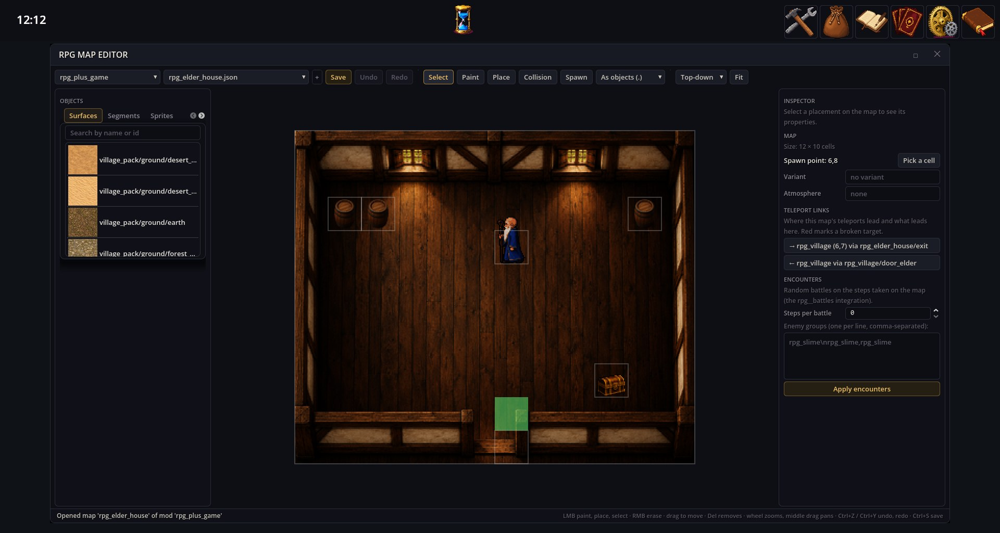
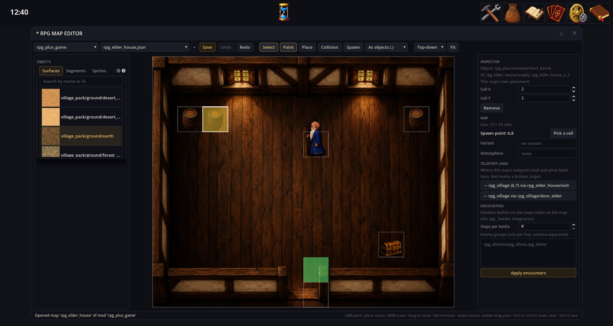

# RPG マップエディタ — マップを描き、オブジェクトを配置する

RPG マップエディタは、ゲームの実行中に RPG 世界のタイルマップを変更します。地面と壁を描き、スプライトやキャラクターをマスに置き、衝突判定を描き、出現地点を動かし、ランダム遭遇を設定できます。**Save**（保存）を押すとマップのファイルが書き込まれ、ゲームは再起動なしで新しいマップをすぐに歩けるようになります。

ツールボックス（ツールバーのハンマー）から **RPG Map Editor** として開きます。開くのは、ゲームが今表示しているマップです。別のマップを開くにはマップ選択欄を使います。

## マップからイベントとオブジェクトを作成

**イベント**を押して矩形をドラッグします。**踏んだとき**または**使用時（E / F）**を選び、コマンドを入力し、**イベントを適用**して保存します。別のオブジェクトやシナリオファイルは不要です。

選択ツールで移動や角からのサイズ変更ができます。両投影に対応します。追加設定で条件、共有シナリオ、転送先を選択できます。一度限りなら条件を `self.done != 1` にし、最後に `flag self.done 1` を書きます。イベントは描画されず、初期状態では通行可能です。

パレット下の**新規オブジェクト…**で現在のマップの Mod にフォームを開きます。画像と動作を設定して保存するとパレットが更新され、選択して配置できます。

## ウィンドウの内容

- **ツールバー** — モッドとマップファイル（**+** で新しいマップ）、**Save**、**Undo**、**Redo**、七つのツール、衝突コードの選択欄、投影の選択欄（**Top-down** または **Isometric**）、マップ全体を表示する **Fit**。
- **パレット**（左）— 物体の形状別に **Surfaces**、**Segments**、**Sprites**、**Actors** の四つと、`Charset` を持つキャラクターの **Characters** タブがあります。各タブに検索とサムネイルがあります。
- **マップ**（中央）— ゲーム自身のレンダラで描かれたマップ。細い枠は各配置が占めるマスを示し、選択中の配置は塗りつぶされます。
- **インスペクタ**（右）— 選択中の配置、マップの設定、テレポートの接続、遭遇。

投影の選択は描き方だけを変えます。どちらの投影でも同じマップであり、編集中に切り替えられます。

## ツール

- **Select** — 配置をクリックして選択します。別のマスへドラッグすると移動し、**Delete** で削除、**Esc** で選択を解除します。
- **Paint** — パレットで地面または分割部品を選び、マスをクリックするかドラッグして描きます。地面は地表を、分割部品は構造層を描きます。右クリックで消去します。
- **Place** — スプライトまたはキャラクターを選び、マスをクリックします。カーソルにはオブジェクトの仮の姿がついてきて、オブジェクトがマスを塞ぐ場所では赤くなります。 「キャラクター」タブ（最後のタブ）は、キャラクターをアクターオブジェクトとして配置します。選んだ時点でオブジェクトがマップのMod（`objects/characters.json`）に書き込まれ、加入シナリオを持つキャラクターは話しかけると仲間に加わります（キャラクターエディタを参照）。
- **Collision** — マスの通行可否を描きます。**As objects (.)** はオブジェクトに任せ、**Blocked (#)** は塞ぎ、**Forced open (o)** は強制的に通れるようにします。
- **Spawn** — マスをクリックして、プレイヤーの出現地点をそこに置きます。インスペクタの **Pick a cell** ボタンでこのツールに切り替わります。

地面をドラッグで描くと、そのマスが見えるように示されます。描いた一筆、配置、移動、衝突の変更、出現地点の変更は、それぞれ元に戻す一手順です。

スプライトを置くには、**Sprites** タブで選び、**Place** を有効にして、マスをクリックします。新しい配置は選択された状態になり、インスペクタにすぐ表示されます。既存の配置を **Select** でクリックすると、そのプロパティがインスペクタに表示されます。

## インスペクタ

- **配置** — オブジェクトの名前と id、そして配置の出どころ。このマップ自身の配置には *This map's own placement* と表示されます。他のモッドの配置にはそのモッド名が表示され、あなたの変更は自分のモッドのパッチとして書かれ、相手のモッドのファイルは変わりません。**Cell X** と **Cell Y** を変更でき、**Remove** で削除、**Reset** で自分のモッドのパッチを外し、ゲームが所有者の配置を再び見るようにできます。
- **相互作用** — プレイヤーが使う、または踏んだときに起きること。**内容**は**アイテムを与える**（アイテム選択と**個数**）、**別のマスまたはマップへ移動**（マップ選択、目標 X と Y、向き、**マップ上でマスを選ぶ**）、**ダイアログを開く**（シナリオ選択）、**ショップを開く**（ショップ選択）、**なし**から選びます。**タイミング**は使用時（オブジェクトに向いて E か F）か踏んだときです。選択はこの配置だけオブジェクト自身の相互作用を置き換えます（チェストが持つコマンドも置き換わります）。別のマップのマスを選ぶには、先に保存してください。エディタがそのマップを開き、到着マスをクリックすると、元のマップが目標を書き込んだ状態で再び開きます（Ctrl+S で保存、Esc で取り消し）。すでに独自の相互作用を持つ他のMODの配置では、その項目の一部を削除する選択はパッチでは削除できないため拒否されます。持ち主のファイルを変更してください。
- **マップ** — マス単位のサイズ、出現地点（**セルを選ぶ**）、**バリアント**（このマップのバリアントでのオブジェクトの見た目）、**雰囲気**（例：`woodland`；なしは「なし」）。どちらも一覧から選びます。
- **テレポート接続** — このマップのテレポートの行き先と、ここへ来るテレポート。マップ上では、青い矢印がドアからこのマップ内の目標マスへ向かうか、他のマップ名の方向へ出ていきます。緑の矢印は他のマップから来ます。赤い矢印は目標が壊れていることを示します。一覧も同じ接続を示します（→ 出る、← 入る）。接続をクリックすると目標マップを開きます。赤い印は目標が壊れていることを示し、マップがない、マスが範囲外、またはブロックされたマスです。
- **遭遇** — ゲームにランダム戦闘の連携（`rpg__battles`）がある場合にだけ表示されます。**Steps per battle** は戦闘と戦闘の間の平均歩数です（0 で遭遇なし）。**Enemy groups** は一行に一グループを書き、敵はカンマで区切ります。**Apply encounters** で書き込みます。
- **敵のグループを追加...**（同じ欄）は、その敵だけのグループとして行を追加します。行を編集すると複数の敵を一つのグループにまとめられます。
- **状態のプレビュー** — 状態や `self.` フラグを使う相互作用を持つ配置では、インスペクターがそのフラグをチェックボックスで並べます。フラグをオンにすると、ゲーム自身の規則で適用される状態を表示します。プレビューだけです：値はウィンドウを開いている間だけ保持され、何も保存されず、ゲームのフラグも変わりません。キャンバスはオブジェクト自身の見た目を描き続けます。状態に応じたスプライトの切り替えは行いません。

## 保存と変わるファイル

- **Save**（Ctrl+S）は、まずマップと配置を検証します。問題があれば保存を止め、状態行に問題の箇所が表示されます。問題がなければ、変更されたファイルだけを選んだモッドに書き込みます。
- **+** で作った新しいマップ（16 × 12 マス、出現地点は 1,1）は、最初の保存でシーンと一緒に書き込まれます。その後はゲームがすぐにそのマップを認識します。
- 依存しているモッドのマップも開けます。そのマップへの描画は、あなたのモッドのパッチに線として書かれます。所有者のマップファイルはバイト単位で元のままです。
- 他のモッドのマップに配置を追加することはできません。書き込めるのはフォルダとしてインストールされたモッドだけです。

## 未実装

参照を更新するマップ・配置の名前変更、選択した配置物をそのエディタで開く操作、配置固有の状態・バリアントのフォームは未実装です。範囲選択、コピーと貼り付け、効果マスク、操作の選択欄は利用できます。

## うまくいかないとき

1. **ファイル一覧にマップがない。** 選んだモッドにも、その依存先にもありません。
2. **Save が何もせず、状態行に問題が出ている。** マップか配置が無効です。状態行が示すマスや値を直してください。
3. **ゲームが新しいマップを知らない。** まず保存してください。マップとシーンは最初の保存でのみ書き込まれます。
4. **配置が拒否される。** オブジェクトがスプライトでもアクターでもない、マスがマップの外にある、またはマップが別のモッドのものです。
5. **遭遇のパネルがない。** ゲームにランダム戦闘（`rpg__battles`）がありません。

## マップ所有イベントと任意の戦闘

不可視領域はマップの `Events` に直接保存します。局所 `Id`、`X`、`Y`、`Width`、`Height`、`Trigger`、`When`、`Solid`、そして `Scenario` と `Commands`、または単独の `Teleport` を指定します。オブジェクトや配置は不要です。`self.done` は `<map>/<event>:done` に属するため ID を維持してください。エディターで Event を選び、矩形を描き、コマンドを入力して Apply event、Save を押します。

## 選択、効果、試遊

Select で矩形をドラッグすると複数選択、Ctrl+A で全選択、Ctrl+C でコピー、Ctrl+V でポインタのマスへ相対位置を保って貼り付けます。操作ごとに一回で元に戻せます。テレポートの矢印で入口や到着点を移動でき、別マップからの到着点は元のファイルか選択 MOD のパッチに保存します。

**Effects** でプロファイルを選び、左ボタンでマスクを塗り、右ボタンで消します。Effects Editor の **Open map editor** から選択済みプロファイルで開けます。空のマスクは削除されます。

**Collision** は両投影で通行不可を赤く表示します。左ボタンは選択した記号、右は `o` を書いて物体を含め強制的に通行可能にします。`#` は遮断、`.` は `Solid` と `Footprint.Solid` に委ねます。一筆が Ctrl+Z/Y の一操作です。

画像のないイベントは Select で四隅をドラッグして `X`、`Y`、`Width`、`Height` を一括変更できます。旧式の配置は `Footprint.Size` を変えます。最低一マス、マップ内に収まります。

Save は不足している依存だけを `depends` に追加し、所有元のファイルは保持します。**Play from here** は保存後、最後に押したマス（なければ開始位置）から試遊します。RPG のプレイ中に使えます。地表、セグメント、スプライト、アクターに加え **Characters** タブから `Charset` を持つキャラクターを配置できます。

**Gives an item** だけでは毎回品を渡します。一度限りならフラグと状態または条件が必要です。イベントに `self.done != 1` の条件を付け、最後に `flag self.done 1` を実行します。

最初の制作では RPG Plus の構成から MOD を作り、ゲームを起動し、マップを作って保存します。地面と宝箱を置き、インスペクタで操作を設定し、ドアイベントと会話 NPC を足します。`Charset` と会話後加入の設定を持つ仲間は Characters から置き、会話後に加入します。Play from here と E/F で確認します。
