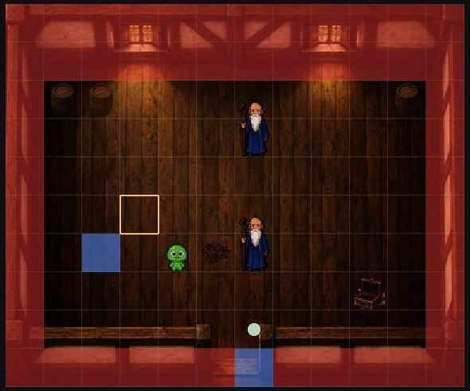
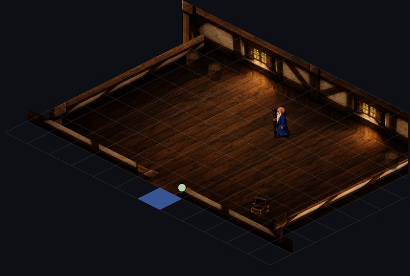

# RPG Map Editor — 타일 맵을 그리고 이벤트 배치하기

RPG 맵 에디터는 게임이 실행되는 동안 RPG 엔진의 타일 맵을 편집합니다. 타일 레이어 3개, 벽과 통로, 플레이어 시작 지점, 랜덤 전투, 그리고 이벤트 — 캐릭터, 표지판, 문, 주울 수 있는 아이템까지. 저장하면 맵이 곧바로 게임에 반영되고, **플레이**로 직접 걸어 볼 수 있습니다.

툴박스(툴바의 망치)에서 **RPG 맵 에디터**로 열리며, 플레이어가 서 있는 맵을 대상으로 합니다.

## 편집 하나와 그 결과

편집 전의 RPG Plus 장로의 집:

에디터에서는 **Appearance**(외형) 탭에서 상인 캐릭터 시트를 고르고, **Place NPC**(NPC로 배치)를 누른 뒤 빈 칸을 클릭합니다. 새 이벤트는 **이벤트** 레이어에서 선택되고 속성이 오른쪽에 표시됩니다:

**저장**(Ctrl+S) 후에는 상인이 집 안에 서 있습니다:

그의 대화와 행동은 이벤트 속성에서 정합니다. 시나리오, 조건, 발동 방식입니다.

## 레이어와 도구

- **배경**, **메인**, **전경** — 타일 레이어입니다. 배경과 메인은 막힌 타일로 이동을 막을 수 있고, 전경은 캐릭터 위에 그려지며 절대 막지 않습니다.
- **충돌** — 타일 위에 칠합니다: *벽*(항상 막힘), *통로*(항상 지나갈 수 있음), *자동*(타일에 따름).
- **이벤트** — 클릭으로 선택하거나 끌고, 빈 칸을 더블클릭해 추가하고, Del로 삭제합니다.
- **연필**, **지우개**, **채우기**. 오른쪽 버튼은 지우기, Alt+클릭은 타일 집기, 1–5 키는 레이어 전환, B/E/G는 브러시 전환입니다.
- **되돌리기**/**다시 실행**(Ctrl+Z / Ctrl+Y), 격자, 확대·축소(Ctrl+휠).

왼쪽 탭: **타일**(맵 타일셋 팔레트, 집이나 나무 같은 온전한 물체를 한 번에 찍을 수 있음), **캐릭터**(전투 스탯이 있는 캐릭터, 적으로 배치), **아이템**(개수를 정해 주울 수 있게 배치), 그리고 **Appearance**(불러온 모드의 모든 스프라이트, NPC로 배치).

오른쪽 열에는 맵 속성이 있습니다: 이름 키, 타일셋, 크기, 배율, 고정 환경광과 분위기, 시작 지점과 방향, 그리고 랜덤 전투(약 N걸음마다, `slime; wolf,slime` 같은 적 그룹).

## 탑다운과 아이소메트릭

에디터는 게임과 같은 방식으로 맵을 그립니다. 툴바의 보기 전환기는 미리 보기만 바꾸고 맵 데이터는 그대로입니다. 아이소메트릭 미리 보기의 집:

게임 자체의 보기는 컬렉션 설정 `tile.renderer`(`topdown` 또는 `isometric`)가 정합니다. `--editor-renderer=isometric`로 시작하면 에디터가 처음부터 아이소메트릭 미리 보기로 열립니다.

## 어떤 파일에 기록되는가

- 맵 자체는 자기 `maps/<id>.json`에 저장됩니다.
- 이벤트는 같은 모드 안의 그 맵 고유의 이벤트 파일(`map_events/<맵>/…`)에 기록됩니다. 다른 파일이나 다른 모드가 맵에 추가한 이벤트는 점선 테두리와 함께 흐리게 표시되며 절대 다시 쓰이지 않고, 그 id는 재사용할 수 없습니다.
- 파일 목록 옆의 **+**는 선택한 모드에 새 맵을 만듭니다. 저장하면 게임이 곧바로 씬으로 인식합니다.
- 기록할 수 있는 것은 폴더로 설치된 모드뿐입니다.

## 문제가 생겼을 때

1. **플레이가 게임이 씬을 모른다고 말한다.** 그 맵의 모드에 `scenes/<id>.json`이 필요합니다.
2. **이벤트가 선택되지 않는다.** 다른 파일이나 모드의 것입니다(점선 테두리).
3. **NPC가 말하지 않는다.** 이벤트에 시나리오가 없거나, 발동이 액션 키가 아닙니다.
4. **저장하면 건드리지 않은 줄까지 바뀐다.** 에디터는 자기 순서대로 파일을 쓰고 이벤트의 기본값도 채워 넣으므로, diff가 편집보다 많은 것을 보여 줄 수 있습니다.
