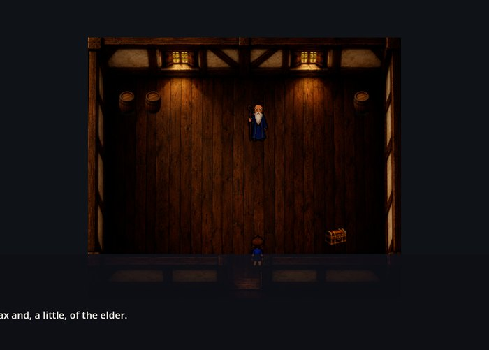

# RPG Map Editor — рисование тайловых карт и расстановка событий

RPG Map Editor правит тайловые карты движка RPG прямо во время игры: три слоя тайлов, стены и проходы, точку появления героя, случайные бои и события — персонажей, таблички, двери, подбираемые предметы. Сохранение сразу обновляет карту в запущенной игре, а кнопка **Играть** позволяет по ней пройтись.

Открывается редактор из набора инструментов (молоток на панели инструментов) как **Редактор RPG-карт** — для той карты, на которой сейчас стоит игрок.

## Правка и её результат в игре

Дом старейшины из RPG Plus до правки:

В редакторе: вкладка **Внешность**, спрайт торговца, кнопка **Разместить NPC**, клик по свободной клетке. Новое событие выбрано на слое **События**, его свойства — справа:

![Редактор RPG-карт на файле rpg_demo_game / rpg_elder_house.json: список «Внешность» с выбранным merchant · village/merchant, карта, где старейшина и новый торговец обведены рамками как события, а события из других файлов — пунктирными рамками; справа свойства карты (тайлсет village, 12 × 10, точка появления 6, 8 со взглядом вверх) и новое событие npc_village_merchant в клетке 9, 3 с чарсетом village/merchant, взглядом вниз и запуском по клавише действия (E/F). Строка состояния сообщает, что «merchant» размещён как NPC.](assets/editor-npc.jpg)

После **сохранения** (Ctrl+S) торговец стоит в доме:

Его диалог и поведение задаются в свойствах события: сценарий, условие, способ запуска.

## Слои и инструменты

- **Фон**, **Основной**, **Передний** — слои тайлов. Фон и Основной могут перекрывать проход непроходимыми тайлами; Передний рисуется поверх персонажей и никогда не блокирует.
- **Коллизии** — рисуется поверх тайлов: *Стена* (всегда непроходимо), *Проход* (всегда проходимо) или *Авто* (по тайлам).
- **События** — клик выбирает событие; события текущего файла можно перетаскивать и удалять (Del), двойной клик по пустой клетке добавляет новое. События других файлов сначала доступны для просмотра; кнопка **Редактировать исходный файл** переключает редактор на их источник.
- **Карандаш**, **Ластик**, **Заливка**; правая кнопка мыши стирает, Alt+клик берёт тайл, клавиши 1–5 переключают слои, B/E/G — кисти.
- **Отменить**/**Вернуть** (Ctrl+Z / Ctrl+Y), сетка, масштаб (Ctrl+колесо).

Вкладки слева: **Тайлы** (палитра тайлсета карты; целые объекты вроде дома или дерева можно ставить одним штампом), **Персонажи** (персонажи с боевыми характеристиками, размещаются как враги), **Предметы** (раскладываются как подбираемые предметы с количеством) и **Внешность** (все спрайты загруженных модов, размещаются как NPC).

На слоях тайлов правый столбец показывает свойства карты; на слое **События** — выбранное событие. Свойства карты: ключ имени, тайлсет, размер, масштаб, своё освещение и атмосфера, точка появления и направление взгляда, а также случайные бои (примерно раз в N шагов, группы врагов вида `slime; wolf,slime`).

## Замена домов и удаление фрагментов

Целый объект из палитры ставится одним штампом. Если новый объект перекрывает клетку старого на том же слое, редактор удаляет старый объект целиком, включая его части на других слоях. Отменить замену можно одним Ctrl+Z.

Ластик удаляет целый объект. В изометрии нажимайте прямо на видимый фрагмент: так можно убрать и старый «хвост». Выберите слой, на котором находится нажатая часть. **Shift + ластик** стирает только одну клетку; **Shift + клик в палитре** выбирает отдельный тайл вместо целого объекта.

## Части объекта на разных слоях

1. Откройте **Редактор тайлсетов** с панели инструментов и выберите тайлсет с объектом.
2. Выделите клетки основания и установите **Слой при размещении → Основной (2)**.
3. Выделите клетки крыши и установите **Передний (3)**. Цифры на клетках показывают назначенные слои.
4. Сохраните тайлсет. Вернитесь в редактор карты, заново выберите объект в палитре и поставьте его одним кликом: части попадут на назначенные слои.

Значение **Активный слой карты** оставляет выбор слоя за редактором карты. Назначение в тайлсете действует при последующем размещении; уже поставленные объекты нужно разместить заново.

## Открываемые бочки и сундуки

1. Выберите слой **События** и нажмите на бочку.
2. Справа указан её источник. Если событие показано пунктиром, нажмите **Редактировать исходный файл**. Например, бочки деревни RPG Plus принадлежат файлу `rpg_plus_game/map_events/rpg_village/barrels.json`.
3. На вкладке основного события задаются закрытый вид и команды первого открытия: установка флага и выдача награды.
4. На вкладке **Дополнительные состояния** выберите состояние открытой бочки. Здесь меняются условие (например, флаг открытия равен 1), изображение `desert/barrel_open` и команды повторного взаимодействия. Награду в эти команды добавлять не нужно.
5. Сохраните (Ctrl+S). Изменения попадут в исходный файл событий; при правке только событий файл карты не перезаписывается.

Последнее состояние с выполненным условием имеет приоритет. Пустое условие выполняется всегда. Новое состояние создаётся с пустыми командами, чтобы повторно не выдавать награду основного события. Маршрут, освещение и другие поля существующего состояния сохраняются, хотя форма состояний их не показывает.

## Вид сверху и изометрия

Редактор рисует карту так же, как её рисует игра. Переключатель вида на панели инструментов меняет только предпросмотр; данные карты остаются прежними. Дом в изометрическом предпросмотре:

Сам вид игры задаёт настройка коллекции `tile.renderer` (`topdown` или `isometric`); ключ `--editor-renderer=isometric` открывает редактор сразу в изометрическом предпросмотре.

## Какие файлы записываются

- Сама карта сохраняется в свой `maps/<id>.json`.
- Новые события по умолчанию попадают в `map_events/<карта>/events.json` мода карты. После **Редактировать исходный файл** сохраняется выбранный файл событий указанного мода. Остальные события остаются приглушёнными, с пунктирной рамкой; их id нельзя использовать повторно.
- **+** рядом со списком файлов создаёт новую карту в выбранном моде; после сохранения игра сразу знает её как сцену.
- Записывать можно только в моды, установленные папками.

## Если что-то пошло не так

1. **«Играть» сообщает, что игра не знает сцену.** Карте нужен файл `scenes/<id>.json` в её моде.
2. **Поля события недоступны.** Выберите его на слое **События** и нажмите **Редактировать исходный файл**. Запись доступна для модов, установленных папками.
3. **NPC не разговаривает.** У его события нет сценария, либо запуск у него не по клавише действия.
4. **Сохранение меняет строки, которые вы не трогали.** Редактор записывает файлы в своём порядке и добавляет значения по умолчанию для полей событий, поэтому diff может показать больше, чем сама правка.
