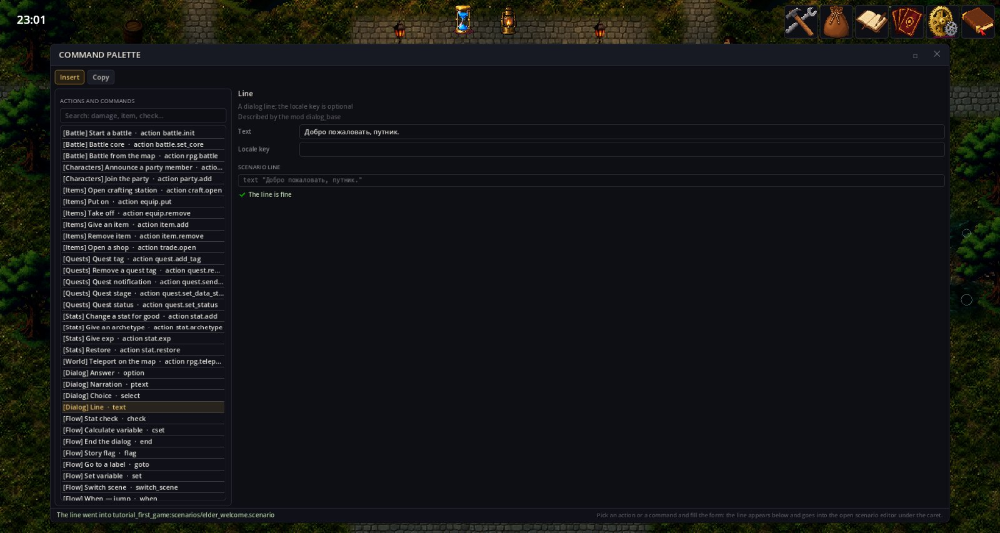
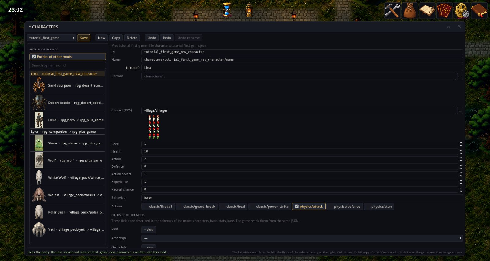

# Редактор RPG-карт — рисование карт и расстановка объектов

Редактор RPG-карт меняет плиточные карты RPG-мира, пока игра запущена. Здесь рисуют землю и стены, ставят спрайты и персонажей на клетки, рисуют коллизию, двигают точку появления игрока и задают случайные встречи. **Сохранить** записывает файлы карты, и игра сразу ходит по новой версии карты — без перезапуска.

Открывается из набора инструментов (молоток на панели) как **RPG Map Editor** (в интерфейсе — «RPG Map Editor»). Открывается на той карте, которую сейчас показывает игра; другую карту выбирают в списке карт.

## Расстановка света

Откройте из молотка **Редактор освещения** и выберите в нём **RPG-карты**. Он показывает ту же карту в виде сверху или изометрии и ставит независимые источники без объектов и картинок — например, поверх фонарей на готовом заднике. Двойной клик добавляет источник, перетаскивание двигает; слева задаются радиус в клетках, сила и цвет. **Ночной предпросмотр** позволяет видеть свет на дневной карте, не меняя её режима. Ctrl+S сохраняет карту или патч в выбранный мод. Подробности — [в справке редактора освещения](../../light_editor/docs/ru.md).

## Событие с нуля и новый объект

Нажмите **Событие** и протяните прямоугольник по нужным тайлам. Справа выберите **При наступлении** или **При использовании (E / F)**, введите команды сценария и нажмите **Применить событие**, затем **Сохранить**. Можно обойтись одним коротким сценарием прямо здесь: отдельные объект и файл сценария не нужны.

Выбранную область можно перетаскивать и менять за углы в обеих проекциях. Дополнительные настройки позволяют задать условие (`self.done != 1` для события до его завершения), выбрать общий сценарий или переход. В конце одноразового сценария поставьте `flag self.done 1`. Событие не рисуется в игре. По умолчанию оно не блокирует проход.

Для предмета или NPC с картинкой нажмите **Новый объект…** под палитрой: форма откроется сразу в моде текущей карты. Задайте картинку и взаимодействие, сохраните объект, затем выберите его в обновившейся палитре и поставьте на карту.

## Размер области события и коллизии

В режиме **Выделить / Select** выберите событие без картинки (триггер или дверь). У четырёх углов его области появятся белые квадраты. Потяните угол: область меняется по клеткам, противоположный угол остаётся на месте. Это работает и в изометрии, и в виде сверху, при любом масштабе. Перетаскивание внутри области по-прежнему переносит событие; щелчки без перетаскивания сохраняют выбор объектов, стоящих друг на друге.

Размер и положение записываются только при отпускании ЛКМ, одним шагом отмены **Ctrl+Z**. Минимум — одна клетка, границы не выходят за карту. Событие карты меняет `X`, `Y`, `Width`, `Height` в `Events`; старая расстановка без картинки меняет свой `Footprint.Size`. Общий объект и другие экземпляры не меняются. Чужие данные сохраняются патчем в вашем моде.

Нажмите **Коллизия / Collision**: непроходимые клетки сразу выделятся полупрозрачным красным, включая коллизию земли, стен, объектов, событий и НПС. В изометрии подсветка имеет форму клеток-ромбов. **ЛКМ** рисует выбранный код (по умолчанию **Заблокировано / #**), **ПКМ** принудительно открывает проход (**o**), в том числе через твёрдый объект, событие или НПС. Явные коды карты `o` и `#` имеют приоритет над `Solid`, маской `Footprint.Solid` и состояниями объектов; `.` возвращает решение объектам. Для восстановления естественной проходимости выберите **Как объекты / .** и рисуйте ЛКМ.

Маска обновляется при нажатии и во время мазка; отпускание мыши записывает весь мазок одним шагом отмены. **Ctrl+Z / Ctrl+Y** сразу обновляют подсветку. При выборе другого инструмента маска скрывается; изменения остаются в документе до сохранения.

## Первая игра за 10 минут

Этот путь делает маленькую игру только мышью и клавиатурой. Текстовый редактор и файлы JSON не нужны. Окна те же, что описаны на этой странице, и в каждом шаге сказано, куда нажимать. Тот же путь повторяет автоматический тест `tutorial_first_game`.

1. **Создайте мод.** В главном меню откройте **Моды и коллекции**, вкладку **Коллекции** и выберите игру **RPG Plus**. На её панели нажмите **Новый мод**. Введите **Название** (идентификатор заполнится сам), оставьте основу **rpg_plus_game** (контент самой игры стоит первым в списке) и нажмите **Создать мод**. Мод войдёт в игру. Закройте игру: новый мод начинает работать при следующем запуске.
2. **Сделайте карту.** Выберите **Играть**, затем **RPG Plus**, затем **Новая игра**. В игре откройте панель инструментов (молоток на панели) и выберите **RPG Map Editor**. На панели выберите свой мод, нажмите **+**, введите название карты и нажмите **OK**. Нажмите **Сохранить**, чтобы записать карту.
3. **Нарисуйте землю.** На вкладке **Поверхности** найдите `grass`, выберите его, включите **Рисовать** и проведите мышью по карте. Найдите `forest_path` и проведите тропинку от нижнего края к середине. Ctrl+Z отменяет мазок.
4. **Поставьте дома и деревья.** На вкладке **Спрайты** найдите `cottage` и поставьте его инструментом **Поставить** (один щелчок на один объект). Затем найдите `oak` и поставьте два-три дерева. Чтобы убрать объект, выберите его инструментом **Выделить** и нажмите Del.
5. **Сундук, который даёт предмет.** На вкладке **Спрайты** найдите `chest` и поставьте его. Щёлкните по нему инструментом **Выделить**. В инспекторе, в разделе **Взаимодействие**, выберите **Делает** → **Выдаёт предмет**, в выборе предмета возьмите **Плащ лесного стража**, **Количество** оставьте 1. Нажмите **Сохранить**. Ваш мод получает `village_pack` через свою основу `rpg_plus_game`, поэтому манифест остаётся прежним, а строка состояния не пишет **Добавлена зависимость**. Редактор добавляет зависимость, только если ваш мод не получает этот мод через свою основу; тогда строка состояния пишет **Добавлена зависимость от …**. Манифест вы не редактируете.

   
6. **Дверь обратно в деревню.** Нажмите **Событие** и выделите область у правого края карты. Откройте **Дополнительные настройки**, выберите карту **rpg_village**, оставьте **При наступлении** и нажмите **Применить событие**. Сохраните карту, затем нажмите **Выбрать клетку на карте**: выберите место прибытия в деревне. Редактор вернёт вас на свою карту; сохраните новый адрес перехода.

   
7. **NPC с диалогом.** Откройте из панели инструментов **Редактор сценариев** и нажмите **Новый сценарий**. Выберите свой мод, введите `elder_welcome` и нажмите **Создать**. Откройте из панели инструментов **Палитру команд**, выберите **text**, введите приветствие в его поле и нажмите **Вставить**: строка попадёт в сценарий. Удалите строку-заглушку `text "…"`, с которой начинается новый сценарий, и нажмите **Сохранить** (Ctrl+S). Вернитесь к карте, откройте вкладку **Актёры**, найдите `villager`, поставьте его, выберите и в **Взаимодействие** выберите **Делает** → **Открывает диалог** и сценарий **elder_welcome** в выборе. Нажмите **Сохранить**.

   
8. **Спутница.** Держите редактор карты открытым. Откройте из панели инструментов **Редактор персонажей** и нажмите **Новый**. Введите **Имя**: Lina, в **Чарсет (RPG)** нажмите кнопку **…** и выберите `village/villager`. Отметьте **Присоединяется к отряду при разговоре** и нажмите **Сохранить**: вкладка **Персонажи** открытого редактора карты сразу покажет её. Откройте **Редактор сценариев**, нажмите **Новый сценарий**, выберите свой мод, введите `lina_hello` и нажмите **Создать**. Вставьте её строку палитрой, как в шаге 7, и нажмите **Сохранить**. Шаблон оставьте как есть, со строкой-заглушкой и строкой `end`: строки вступления идут после конца сценария, так что Лина скажет свою строку и затем вступит в отряд. В редакторе карты выберите **Lina** на вкладке **Персонажи** (последней) и поставьте её рядом с дверью. Выберите её и в **Взаимодействие** выберите **Делает** → **Открывает диалог** и **lina_hello** в выборе. Инспектор пишет **После диалога этот персонаж вступает в отряд**. Нажмите **Сохранить**.

   
9. **Играть отсюда.** Щёлкните по тропинке у нижнего края карты и нажмите **Играть отсюда** на панели, рядом с **Сохранить**. Игра начнётся на вашей карте в этой клетке. Ходите клавишами W, A, S и D. Встаньте рядом с сундуком, повернитесь к нему и нажмите E: вы получите **Плащ лесного стража**. Встаньте рядом с жителем, повернитесь к нему и нажмите E: его диалог заиграет. Встаньте рядом с Lina, повернитесь к ней и нажмите E: она скажет свою строку, вступит в отряд и пойдёт за вами. Последним наступите на дверь: карта сменится на **rpg_village**.

   
10. **Наденьте находку.** Откройте **Лист персонажа** с панели игры, выберите героя в списке отряда и нажмите **Надеть…** в пустом слоте **Тело**. Выберите **Плащ лесного стража** из сумки. Защита героя растёт сразу.

   

Замечания к этому пути:

- **Играть отсюда** работает только пока запущена игра с RPG. Откройте редактор из панели инструментов игры, как сказано в шаге 2.
- Клетка цели двери выбирается на другой карте, поэтому сохраните свою карту до нажатия **Выбрать клетку на карте**.

## Что видно в окне

- **Панель инструментов** — мод и файл карты (**+** создаёт новую карту), **Save**, **Undo**, **Redo**, семь инструментов, выбор кода коллизии, выбор проекции (**Top-down** или **Isometric**) и **Fit**, который показывает всю карту.
- **Палитра** (слева) — четыре вкладки форм объектов: **Surfaces**, **Segments**, **Sprites**, **Actors**, а также **Characters** для персонажей с `Charset`. Во вкладках есть поиск и миниатюры.
- **Карта** (в середине) — карта, нарисованная собственным рендерером игры. Тонкие рамки показывают занимаемые клетки каждой расстановки; выбранная расстановка залита.
- **Инспектор** (справа) — выбранная расстановка, свойства карты, её связи телепортов и встречи.

Выбор проекции меняет только отрисовку. Карта в обеих проекциях одна и та же, и проекцию можно переключать прямо во время правки:

## Инструменты

- **Select** — щелчок по расстановке выбирает её; перетаскивание переносит на другую клетку; **Delete** удаляет; **Esc** снимает выделение. Протяните рамку по пустой земле, чтобы выделить несколько расстановок; **Ctrl+A** выделяет все. **Ctrl+C** копирует выделенное, **Ctrl+V** вставляет его с первой расстановкой на клетке под указателем (копии сохраняют взаимное расположение и становятся выделенными). Удаление, копирование и вставка действуют на всё выделение, и каждое — один шаг отмены. Маркеры легко выбрать: расстановка без картинки (триггер, дверь) — залитая клетка поверх построек, и щелчок по её клетке выбирает её раньше здания под ней; повторный щелчок по той же клетке берёт следующую расстановку под ней, а строка состояния называет выбранную. Стрелки тоже ручки. Щелчок по стрелке двери выбирает дверь, перетаскивание её переносит. Наконечник стрелки на клетку этой карты — это цель: перетащите его, чтобы перенести клетку цели. Заблокированная клетка или клетка за пределами карты отклоняется, её призрак красный. Входящая стрелка — это прибытие на эту карту: щелчок выбирает его, инспектор называет карту-источник и расстановку и даёт кнопку, которая открывает эту карту, а перетаскивание переносит клетку прибытия. Изменение записывается в расстановку-источник: в файл её карты или патчем этого мода, если расстановка другого мода, до которого этот мод должен дотягиваться через зависимости. Каждое перетаскивание показывает призрак того места, куда попадёт объект, до отпускания; ничего не переносится до отпускания, а отмена (Undo) откатывает каждое изменение.
- **Effects** («Эффекты») — рисует маску эффекта выбранного рядом с панелью профиля атмосферы (например, туман или снег) по клеткам; правая кнопка стирает. Замаскированные клетки подкрашиваются, а игра показывает эффект только на них. Кнопка **Open map editor** в редакторе эффектов открывает этот инструмент с выбранным профилем.
- **Paint** — выберите поверхность или сегмент в палитре и щёлкайте или ведите мышью по клеткам. Поверхности рисуют землю, сегменты — слой конструкций. Правая кнопка стирает.
- **Place** — выберите спрайт или актёра и щёлкните клетку. За указателем следует призрак объекта; он краснеет там, где объект закрыл бы клетки. Вкладка «Персонажи» (последняя) ставит персонажа как объект-актёр: объект записывается в мод карты (`objects/characters.json`) в момент выбора, а персонаж с сценарием присоединения (см. редактор персонажей) присоединяется к отряду при разговоре.
- **Collision** — рисует проходимость клеток: **As objects (.)** — решают объекты, **Blocked (#)** — клетка закрыта, **Forced open (o)** — клетка открыта принудительно.
- **Spawn** — щелчок по клетке ставит точку появления игрока. Кнопка **Pick a cell** в инспекторе переключает на этот инструмент.

Мазок по поверхности показывает свои клетки, пока ведёте мышью. Каждый мазок, расстановка, перенос, изменение коллизии и точки появления — один шаг отмены.

Чтобы поставить спрайт, выберите его во вкладке **Sprites**, включите **Place** и щёлкните клетку. Новая расстановка сразу выбирается, и инспектор показывает её. Щелчок по уже стоящему объекту инструментом **Select** показывает его свойства в инспекторе:

## Инспектор

- **Расстановка** — название и id объекта и то, откуда расстановка. Собственная расстановка карты написана как *This map's own placement*. Расстановка из другого мода показывает имя этого мода: ваши правки пишутся патчем в ваш мод, файл другого мода не меняется. Можно изменить **Cell X** и **Cell Y**, **Remove** удаляет расстановку, **Reset** снимает патч вашего мода, и игра снова видит расстановку владельца.
- **Взаимодействие** — что происходит, когда игрок использует расстановку или наступает на неё. **Делает**: **Выдаёт предмет** (выбор предмета и **Количество**), **Ведёт в другую клетку или карту** (выбор карты, цели X и Y, взгляд и **Выбрать клетку на карте**), **Открывает диалог** (выбор сценария), **Открывает магазин** (выбор магазина) или **Ничего**. **Когда**: при использовании (E или F, глядя на объект) или при наступлении. Выбор заменяет взаимодействие самого объекта только для этой расстановки, поэтому собственные команды сундука тоже заменяются. Чтобы выбрать клетку на другой карте, сначала сохраните: редактор откроет эту карту, вы щёлкнете клетку прихода, и снова откроется карта, с которой вы пришли, уже с записанной целью (Ctrl+S сохраняет, Esc отменяет). У расстановки другого мода, которая уже имеет своё взаимодействие, выбор, отбрасывающий его поля, отклоняется: патч не может их убрать, меняйте файл владельца.
- **Карта** — размер в клетках, точка появления (**Выбрать клеткой**), **Вариант** (вид объектов в этом варианте карты) и **Атмосфера** (например `woodland`; «нет» — без атмосферы). Оба выбираются из списков.
- **Связи телепортов** — куда ведут телепорты этой карты и какие телепорты ведут сюда. На холсте синяя стрелка идёт от двери к её цели на этой карте или уходит к краю с названием другой карты; зелёная приходит с другой карты; красная означает битую цель. Список показывает те же связи (→ ведёт наружу, ← ведёт сюда). Щелчок по связи открывает карту цели. Красная метка означает битую цель: нет такой карты, клетка за пределами карты или заблокирована. Потяните наконечник синей стрелки на клетку этой карты, чтобы перенести её цель, или потяните зелёную стрелку, чтобы перенести клетку, где игрок появляется на этой карте.
- **Встречи** — показываются, только если в игре есть интеграция случайных боёв (`rpg__battles`). **Steps per battle** — среднее число шагов между боями (0 — встреч нет). **Enemy groups** — по одной группе в строке, враги через запятую; **Apply encounters** записывает их.
- **Добавить группу врагов...** (в этом же разделе) добавляет строку с этим врагом как отдельной группой; отредактируйте строку, чтобы поместить несколько врагов в одну группу.
- **Предпросмотр состояния** — для расстановки, у которой объект имеет состояния или взаимодействие с флагами `self.`, инспектор показывает эти флаги галочками. Отметка флага показывает состояние, которое к нему применяется, по правилу самой игры. Это только предпросмотр: значения живут, пока открыто окно, ничего не сохраняется, флаги игры не меняются. Холст рисует собственный вид объекта: спрайт при смене состояния не переключается.

## Сохранение и какие файлы меняются

- **Save** (Ctrl+S) сначала проверяет карту и её расстановки. Найденная ошибка останавливает сохранение, а строка состояния называет её. Иначе редактор записывает только изменившиеся файлы в выбранный мод.
- Новая карта, созданная кнопкой **+** (16 × 12 клеток, точка появления в 1,1), записывается при первом сохранении вместе со своей сценой. После этого игра знает карту сразу.
- Можно открыть карту мода, от которого ваш мод зависит. Рисование на ней пишется мазками в патч вашего мода; файл карты владельца остаётся побайтно прежним.
- **Играть отсюда** (на панели, рядом с Save) запускает запущенную игру на открытой карте с последней клетки, на которую вы нажали (до нажатия — с точки появления). Несохранённые правки сначала сохраняются, потому что игра играет сохранённую карту. Работает, пока запущена RPG-игра, например когда редактор открыт из внутриигровой панели.
- Расстановки на карту чужого мода не добавляются. Сохранять можно только в моды, установленные папкой.
- **Объекты других модов.** Если карта использует объект чужого мода (поставленный спрайт, нарисованную поверхность) или взаимодействие называет сценарий, карту, предмет или магазин чужого мода, при сохранении этот мод добавляется в `depends` вашего `manifest.json`, и строка состояния пишет «Добавлена зависимость от …». Файл манифеста редактировать не нужно. Игра подхватит новую зависимость при следующем запуске.

## Пока не реализовано

Переименование карты или размещения с обновлением ссылок, открытие выбранного размещённого объекта в его редакторе и формы состояний/вариантов отдельного размещения пока не реализованы. Выделение рамкой, копирование и вставка, маски эффектов и выбор взаимодействия размещения уже доступны.

## Если что-то пошло не так

1. **Карты нет в списке.** Её нет ни в выбранном моде, ни в его зависимостях.
2. **Save ничего не делает, в строке состояния ошибка.** Карта или расстановка неверны; исправьте клетку или значение, которое назвала строка.
3. **Игра не знает новую карту.** Сначала сохраните: карта и её сцена пишутся только при первом сохранении.
4. **Расстановка отклонена.** Объект — не спрайт и не актёр, клетка за пределами карты или карта принадлежит другому моду.
5. **Нет панели встреч.** В игре нет случайных боёв (`rpg__battles`).

## События карты и необязательные бои

Невидимая область хранится прямо в `Events` карты: локальный `Id`, `X`, `Y`, `Width`, `Height`, `Trigger`, `When`, `Solid` и либо `Scenario` с `Commands`, либо отдельный `Teleport`. Объект и расстановка не нужны. `self.done` означает `<карта>/<событие>:done`; сохраняйте устойчивый ID. В редакторе карты выберите «Событие», протяните область, введите команды, нажмите «Применить событие» и «Сохранить».

**Одноразовые награды.** Выбор «Даёт предмет» записывает только выдачу. Чтобы награда не повторялась, добавьте сохраняемый флаг и состояние либо условие события; событие карты может проверять `self.done != 1` и заканчиваться `flag self.done 1`.
