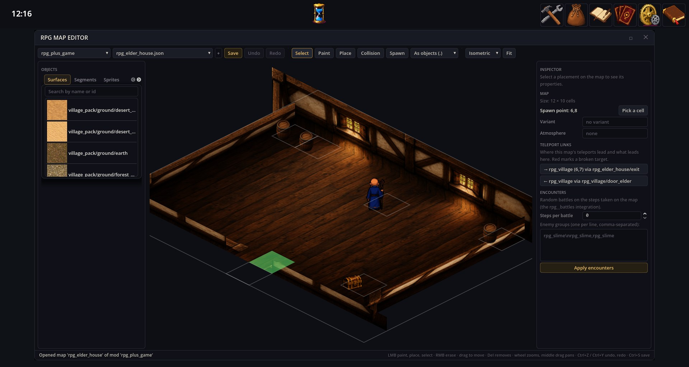
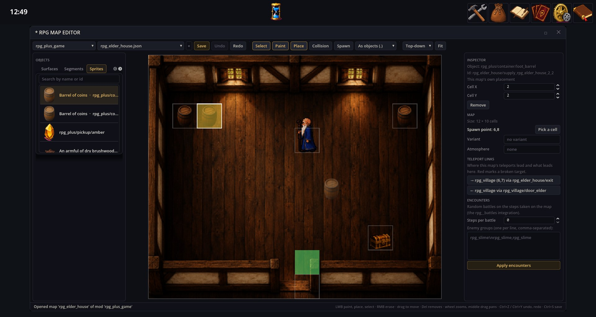

# Trình chỉnh sửa bản đồ RPG — vẽ bản đồ và đặt vật thể

Trình chỉnh sửa bản đồ RPG thay đổi các bản đồ ô gạch của thế giới RPG khi trò chơi đang chạy. Bạn vẽ nền và tường, đặt sprite và nhân vật lên các ô, vẽ va chạm, di chuyển điểm xuất hiện và đặt các trận chiến ngẫu nhiên. **Save** ghi các tệp của bản đồ, và trò chơi đi trên bản đồ mới ngay lập tức, không cần khởi động lại.

Mở từ hộp công cụ (cái búa trên thanh công cụ) với tên **RPG Map Editor**. Cửa sổ mở trên bản đồ mà trò chơi đang hiển thị; muốn mở bản đồ khác, dùng bộ chọn bản đồ.

## Kích thước lưới và vị trí ảnh nền

Trong phần bản đồ bên phải, đặt **Chiều rộng, ô** và **Chiều cao, ô**, rồi nhấn **Đổi kích thước bản đồ**. Cột và hàng mới được thêm ở cuối; các ô, nhân vật và sự kiện cũ giữ nguyên tọa độ. Có thể sửa ô mới ngay. Khi thu nhỏ, vật thể, sự kiện và điểm xuất hiện không được nằm ngoài bản đồ. **Hiện lưới** bật hoặc tắt các đường xem trước.

Trong **Ảnh nền**, chọn ảnh rồi chỉnh X/Y theo từng pixel gốc của bản đồ trước khi phóng. Khung vẽ xem trước ngay; **Áp dụng vị trí** ghi một bước hoàn tác. Lưới, sự kiện, nhân vật và tỷ lệ ảnh không đổi. Các phần ảnh riêng cho từng góc chiếu có vị trí độc lập. **Lưu** giữ kích thước và vị trí; Ctrl+Z hoàn tác thay đổi đã áp dụng.

## Tạo sự kiện và đối tượng ngay trên bản đồ

Nhấn **Sự kiện** rồi kéo hình chữ nhật. Chọn **Khi bước lên** hoặc **Khi dùng (E / F)**, nhập lệnh, nhấn **Áp dụng sự kiện** rồi lưu. Không cần tạo đối tượng hoặc tệp kịch bản riêng.

Dùng công cụ chọn để di chuyển hoặc kéo góc đổi kích thước trong cả hai phép chiếu. Tùy chọn bổ sung có điều kiện, kịch bản chung và dịch chuyển. Với sự kiện một lần, dùng điều kiện `self.done != 1` và kết thúc bằng `flag self.done 1`. Sự kiện không có hình ảnh và mặc định không chặn đường.

Nhấn **Đối tượng mới…** dưới bảng chọn để mở biểu mẫu trong mod của bản đồ. Chọn ảnh và tương tác, lưu rồi chọn đối tượng trong bảng vừa cập nhật để đặt lên bản đồ.

## Bạn thấy gì trong cửa sổ

- **Thanh công cụ** — mod và tệp bản đồ (**+** tạo bản đồ mới), **Save**, **Undo**, **Redo**, bảy công cụ, bộ chọn mã va chạm, bộ chọn phép chiếu (**Top-down** hoặc **Isometric**) và **Fit**, hiển thị toàn bộ bản đồ.
- **Bảng chọn** (trái) — bốn tab theo dạng **Surfaces**, **Segments**, **Sprites**, **Actors**, thêm **Characters** cho nhân vật có `Charset`. Mỗi tab có tìm kiếm và hình thu nhỏ.
- **Bản đồ** (giữa) — bản đồ do chính bộ dựng hình của trò chơi vẽ. Khung mảnh cho biết các ô mà mỗi vị trí đặt chiếm; vị trí đang chọn được tô đầy.
- **Bảng thuộc tính** (bên phải) — vị trí đang chọn, thuộc tính của bản đồ, liên kết dịch chuyển và trận chiến.

Bộ chọn phép chiếu chỉ đổi cách vẽ. Bản đồ là một, và bạn có thể đổi phép chiếu ngay khi đang chỉnh sửa:

## Các công cụ

- **Select** — nhấp vào một vị trí để chọn nó; kéo để chuyển sang ô khác; **Delete** xóa; **Esc** bỏ chọn.
- **Paint** — chọn một mặt nền hoặc một đoạn trong bảng, rồi nhấp hoặc kéo qua các ô. Mặt nền vẽ lớp đất, đoạn vẽ lớp kết cấu. Chuột phải xóa.
- **Place** — chọn một sprite hoặc nhân vật, rồi nhấp một ô. Bóng mờ của vật thể đi theo con trỏ; ô nào vật thể sẽ chặn thì bóng chuyển đỏ. Tab **Nhân vật trò chơi** (tab cuối) đặt một nhân vật làm đối tượng actor: đối tượng được ghi vào mod của bản đồ (`objects/characters.json`) ngay khi chọn, và nhân vật có kịch bản gia nhập sẽ gia nhập đội khi được nói chuyện (xem Trình chỉnh sửa nhân vật).
- **Collision** — vẽ khả năng đi qua của ô: **As objects (.)** để các vật thể quyết định, **Blocked (#)** chặn ô, **Forced open (o)** mở ô bắt buộc.
- **Spawn** — nhấp một ô để đặt điểm xuất hiện của người chơi tại đó. Nút **Pick a cell** trong bảng thuộc tính chuyển sang công cụ này.

Khi kéo để vẽ nền, các ô của nét vẽ được hiện ra. Mỗi nét vẽ, vị trí đặt, lần di chuyển, thay đổi va chạm và thay đổi điểm xuất hiện đều là một bước hoàn tác.

Để đặt một sprite, chọn nó trong tab **Sprites**, bật **Place** rồi nhấp vào ô. Vị trí mới được chọn và bảng thuộc tính hiện ngay. Nhấp một vị trí đã có bằng **Select** sẽ hiện thuộc tính của nó trong bảng:

## Bảng thuộc tính

- **Vị trí** — tên và id của vật thể, cùng nguồn gốc của vị trí. Vị trí riêng của bản đồ ghi *This map's own placement*. Vị trí từ mod khác hiện tên mod đó: thay đổi của bạn được ghi như một bản vá trong mod của bạn, còn tệp của mod kia không đổi. Bạn có thể sửa **Cell X** và **Cell Y**, **Remove** để xóa, hoặc **Reset** để bỏ bản vá của mod bạn, để trò chơi thấy lại vị trí của chủ sở hữu.
- **Tương tác** — điều xảy ra khi người chơi dùng hoặc bước lên vị trí đặt này. **Làm** gồm **Trao vật phẩm** (chọn vật phẩm và **Số lượng**), **Dẫn tới ô hoặc bản đồ khác** (chọn bản đồ, đích X và Y, hướng nhìn và **Chọn ô trên bản đồ**), **Mở hội thoại** (chọn kịch bản), **Mở cửa hàng** (chọn cửa hàng) hoặc **Không gì**. **Khi** là lúc dùng (E hoặc F khi quay mặt về đối tượng) hoặc bước lên. Lựa chọn chỉ thay tương tác của chính đối tượng cho vị trí đặt này, nên lệnh riêng của rương cũng bị thay. Để chọn ô trên bản đồ khác, hãy lưu trước: trình soạn mở bản đồ đó, bạn nhấp vào ô tới, và bản đồ đang sửa mở lại với đích đã ghi (Ctrl+S để lưu; Esc để hủy). Với vị trí đặt của mod khác đã có tương tác riêng, lựa chọn làm mất một trường của nó sẽ bị từ chối vì bản vá không thể bỏ nó; hãy sửa tệp của chủ sở hữu.
- **Bản đồ** — kích thước theo ô, điểm xuất hiện (**Chọn ô**), **Biến thể** (diện mạo đối tượng trong biến thể bản đồ này) và **Không khí** (ví dụ `woodland`; không có thì để trống). Cả hai đều chọn từ danh sách.
- **Liên kết dịch chuyển** — dịch chuyển của bản đồ này dẫn tới đâu và dịch chuyển nào dẫn tới đây. Trên bản đồ, mũi tên xanh đi từ cửa tới ô đích trên bản đồ này, hoặc rời bản đồ về phía tên bản đồ khác; mũi tên xanh lá đến từ bản đồ khác; mũi tên đỏ là đích bị hỏng. Danh sách hiển thị cùng các liên kết (→ đi ra, ← đi vào). Nhấp vào liên kết để mở bản đồ đích. Dấu đỏ nghĩa là đích bị hỏng: không có bản đồ, ô nằm ngoài bản đồ, hoặc ô bị chặn.
- **Trận chiến** — chỉ hiện khi trò chơi có tích hợp trận chiến ngẫu nhiên (`rpg__battles`). **Steps per battle** là số bước trung bình giữa hai trận (0 tắt trận chiến). **Enemy groups** mỗi dòng một nhóm, các kẻ địch cách nhau bằng dấu phẩy; **Apply encounters** ghi lại.
- **Thêm nhóm kẻ địch...** (trong cùng mục) thêm một dòng với kẻ địch đó thành nhóm riêng; sửa dòng để đưa nhiều kẻ địch vào một nhóm.
- **Xem trước trạng thái** — với vị trí đặt có đối tượng có trạng thái hoặc tương tác dùng cờ `self.`, bảng thuộc tính liệt kê các cờ đó thành ô đánh dấu. Đánh dấu một cờ sẽ hiện trạng thái áp dụng theo đúng quy tắc của trò chơi. Đây chỉ là xem trước: giá trị giữ trong lúc cửa sổ mở, không lưu gì, và cờ của trò chơi không đổi. Canvas vẫn vẽ hình của đối tượng: sprite không đổi theo trạng thái.

## Lưu và những tệp nào thay đổi

- **Save** (Ctrl+S) kiểm tra bản đồ và các vị trí trước. Nếu có lỗi, việc lưu dừng lại và dòng trạng thái nêu lỗi đó. Nếu không, trình chỉnh sửa chỉ ghi các tệp đã thay đổi, vào mod bạn đã chọn.
- Bản đồ mới tạo bằng **+** (16 × 12 ô, điểm xuất hiện ở 1,1) được ghi khi lưu lần đầu cùng với cảnh của nó. Từ đó trò chơi biết bản đồ ngay lập tức.
- Bạn có thể mở bản đồ của một mod mà bạn phụ thuộc vào. Vẽ trên bản đồ đó được ghi thành các nét trong một bản vá của mod bạn; tệp bản đồ của chủ sở hữu giữ nguyên từng byte.
- Không thể thêm vị trí vào bản đồ của mod khác. Chỉ có thể lưu vào các mod được cài đặt dưới dạng thư mục.

## Chưa có

Chưa có đổi tên bản đồ/vị trí kèm cập nhật tham chiếu, mở vật thể đã chọn trong trình sửa riêng, và biểu mẫu trạng thái/biến thể của từng vị trí. Chọn hình chữ nhật, sao chép/dán, mặt nạ hiệu ứng và bộ chọn tương tác đã có.

## Khi có lỗi

1. **Bản đồ không có trong danh sách tệp.** Nó không nằm trong mod đã chọn cũng không nằm trong các mod phụ thuộc của mod đó.
2. **Save không làm gì và dòng trạng thái báo lỗi.** Một bản đồ hoặc một vị trí không hợp lệ; sửa ô hoặc giá trị mà dòng trạng thái nêu ra.
3. **Trò chơi không biết bản đồ mới.** Hãy lưu trước: bản đồ và cảnh chỉ được ghi ở lần lưu đầu tiên.
4. **Vị trí bị từ chối.** Vật thể không phải sprite hoặc nhân vật, ô nằm ngoài bản đồ, hoặc bản đồ thuộc mod khác.
5. **Không có bảng trận chiến.** Trò chơi không có trận chiến ngẫu nhiên (`rpg__battles`).

## Sự kiện thuộc bản đồ và chiến đấu tùy chọn

Vùng vô hình được lưu trực tiếp trong `Events` của bản đồ: `Id` cục bộ, `X`, `Y`, `Width`, `Height`, `Trigger`, `When`, `Solid`, cùng `Scenario` và `Commands` hoặc `Teleport` riêng. Không cần đối tượng hay vị trí đặt. `self.done` thuộc `<map>/<event>:done`; giữ ID ổn định. Trong trình sửa, chọn Event, kéo hình chữ nhật, nhập lệnh, Apply event rồi Save.

## Chọn, hiệu ứng và chơi thử

Trong Select, kéo hình chữ nhật để chọn nhiều vị trí. Ctrl+A chọn hết, Ctrl+C sao chép, Ctrl+V dán vào ô dưới con trỏ, giữ khoảng cách tương đối. Mỗi thao tác hoàn tác một bước. Kéo mũi tên dịch chuyển để đổi điểm đi/đến; điểm đến từ bản đồ khác lưu ở tệp nguồn hoặc bản vá của mod chọn.

Trong **Effects**, chọn hồ sơ, LMB tô mặt nạ, RMB xóa. **Open map editor** của Effects Editor mở công cụ với hồ sơ đã chọn. Mặt nạ rỗng bị bỏ.

**Collision** hiển thị ô chặn bằng màu đỏ trong cả hai phép chiếu. LMB tô mã chọn; RMB ghi `o`, mở đường xuyên cả vật thể. `#` chặn, `.` giao lại cho `Solid` và `Footprint.Solid`. Một nét là một bước Ctrl+Z/Y.

Sự kiện không hình có bốn tay nắm góc trong Select. Kéo đổi `X`, `Y`, `Width`, `Height` cùng một bước; vị trí kiểu cũ đổi `Footprint.Size`. Vùng tối thiểu một ô và nằm trong bản đồ.

Save chỉ thêm phụ thuộc thiếu vào `depends`, giữ nguyên tệp chủ sở hữu. **Play from here** lưu rồi vào bản đồ ở ô bấm cuối (hoặc điểm xuất hiện), cần game RPG đang chạy. Ngoài bốn tab bề mặt, đoạn, sprite, actor còn có **Characters** để đặt nhân vật có `Charset`.

Chỉ **Gives an item** sẽ cho lặp mỗi lần dùng. Muốn một lần cần cờ và trạng thái hoặc điều kiện. Sự kiện có thể dùng điều kiện `self.done != 1`, kết thúc bằng `flag self.done 1`.

Lần đầu: tạo mod trong sơ đồ RPG Plus, vào game, tạo và lưu bản đồ, tô nền và đặt rương, chọn tương tác trong bảng thuộc tính. Thêm cửa dạng sự kiện và NPC có kịch bản. Đồng đội có `Charset` và tùy chọn gia nhập sau hội thoại được đặt từ Characters; lời thoại chạy trước khi gia nhập. Dùng Play from here và E/F để kiểm tra.
