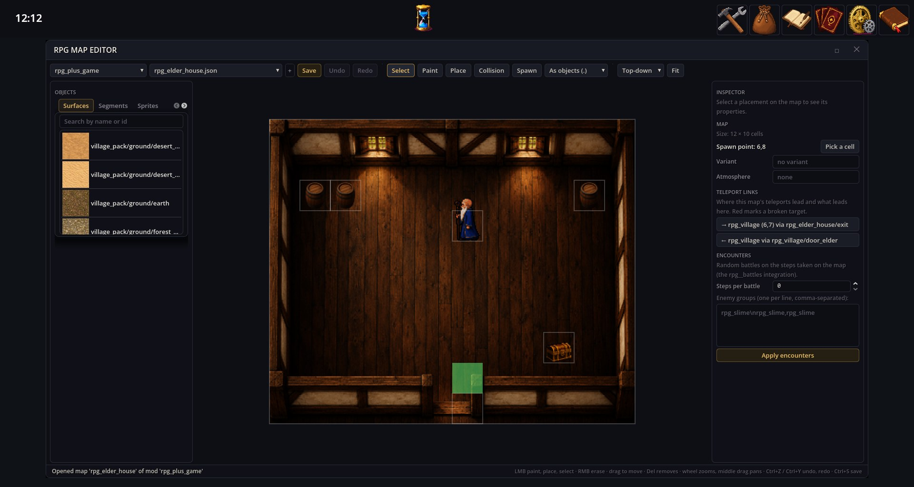

# RPG 地图编辑器 — 绘制地图与放置对象

RPG 地图编辑器可以在游戏运行时修改 RPG 世界的瓦片地图：绘制地面和墙壁，在格子上放置精灵和角色，绘制碰撞，移动出生点，并设置随机遭遇。点击 **保存（Save）** 会写入地图文件，游戏立即使用新地图——无需重启。

它从工具箱（工具栏上的锤子）打开，名称为 **RPG Map Editor**。它会打开游戏当前显示的地图；要打开其他地图，请使用地图选择器。

## 直接在地图上创建事件和物体

点击**事件**并拖出矩形。选择**踩上时**或**使用时（E / F）**，输入剧情指令，点击**应用事件**，再保存。不需要另建物体或剧情文件。

使用选择工具移动区域或拖动角点调整大小，两种投影均可。可选设置支持条件、共享剧情和传送。一次性事件可设置条件 `self.done != 1`，并在脚本末尾添加 `flag self.done 1`。事件不渲染图像，默认不阻挡通行。

点击调色板下的**新建物体…**，表单会在当前地图的模组中打开。设置图片与交互并保存，然后在自动更新的调色板中选择并放置物体。

## 窗口中的内容

- **工具栏** — 模组和地图文件（**+** 新建地图）、**Save**、**Undo**、**Redo**、五种工具、碰撞代码选择器、投影选择器（**Top-down** 或 **Isometric**），以及显示整张地图的 **Fit**。
- **对象面板**（左侧）— 模组中的 RPG 对象，按形状分为四个标签：**Surfaces**（地面）、**Segments**（一格墙或栅栏）、**Sprites**（网格上的物体）和 **Actors**（占据一格的角色）。每个标签都可按名称或 id 搜索，每行有缩略图。
- **地图**（中间）— 由游戏自身渲染器绘制的地图。细框显示每个放置对象占用的格子；选中的放置对象会被填充。
- **检查器**（右侧）— 选中的放置对象、地图属性、传送连接和遭遇设置。

投影选择器只改变绘制方式。两种投影下地图是同一份，编辑时可以随时切换：

## 工具

- **Select** — 单击放置对象即可选中；拖动可将其移到另一格；**Delete** 删除；**Esc** 取消选择。
- **Paint** — 在面板中选择地面或分段，然后单击或拖过格子。地面绘制地表，分段绘制结构层。鼠标右键擦除。
- **Place** — 选择精灵或角色，然后单击一格。对象的虚影会跟随指针；如果对象会挡住格子，虚影会变红。 「游戏角色」标签页（最后一个）把角色作为 actor 对象放置：选中时该对象写入地图所在模组（`objects/characters.json`），带加入剧本的角色在对话时加入队伍（见角色编辑器）。
- **Collision** — 绘制格子的可通行性：**As objects (.)** 由对象决定，**Blocked (#)** 阻挡，**Forced open (o)** 强制开放。
- **Spawn** — 单击一格，将玩家出生点设在那里。检查器中的 **Pick a cell** 按钮会切换到此工具。

拖动绘制时，地面笔画会显示其格子。每一次笔画、放置、移动、碰撞修改和出生点修改都是一步撤销。

要放置精灵，请在 **Sprites** 标签中选择它，启用 **Place**，然后单击格子。新放置的对象会被选中，检查器立即显示它。使用 **Select** 单击已有放置对象，检查器会显示其属性：

## 检查器

- **放置对象（Placement）** — 对象的名称和 id，以及放置对象的来源。本地图自有的放置显示 *This map's own placement*。来自其他模组的放置会显示该模组的名称：你的修改会以补丁形式写入你的模组，其他模组的文件保持不变。你可以修改 **Cell X** 和 **Cell Y**，用 **Remove** 删除，或用 **Reset** 撤销你模组的补丁，使游戏重新看到所有者的放置对象。
- **互动** — 玩家使用或踩上此摆放时发生的事。**作用**可选**给予物品**（物品选择器与**数量**）、**前往另一格子或地图**（地图选择器、目标 X 与 Y、朝向与**在地图上选择格子**）、**打开对话**（剧本选择器）、**打开商店**（商店选择器）或**无**。**时机**为使用时（面向物体时按 E 或 F）或踩上时。所选内容只替换这一个摆放自身的对象互动（箱子自带的命令也会被替换）。要在其他地图上选格子，请先保存：编辑器会打开该地图，点击抵达格子后，你来的地图会重新打开并写入目标（Ctrl+S 保存；Esc 取消）。对于已有自身互动的其他模组的摆放，若会去掉其中某些字段，该选择会被拒绝，因为补丁无法去掉它：请修改所有者的文件。
- **地图** — 格子尺寸、出生点（**选择格子**）、**变体**（此地图变体中对象的外观）和**氛围**（例如 `woodland`；无则为无）。两者都从列表中选择。
- **传送连接** — 此地图的传送通往哪里，以及哪些传送通往此处。地图上，蓝色箭头从门指向本地图的目标格子，或指向另一地图名称离开地图；绿色箭头从其他地图进入；红色箭头表示目标损坏。列表显示相同的连接（→ 离开，← 进入）。点击连接可打开目标地图。红色标记表示目标损坏：地图不存在、格子在地图之外，或格子被阻挡。
- **遭遇（Encounters）** — 只有游戏中存在随机战斗集成（`rpg__battles`）时才会显示。**Steps per battle** 是两场战斗之间的平均步数（0 表示关闭）。**Enemy groups** 每行一组，组内敌人用逗号分隔；**Apply encounters** 写入设置。
- **添加敌人组...**（同一区域）添加一行，该敌人单独成组；编辑该行可把多个敌人放进同一组。
- **状态预览** — 对于其对象的状态或交互中含有 `self.` 标志的摆放，检查器会把这些标志列为复选框。勾选某个标志即显示按游戏自身规则生效的状态。这只是预览：数值在窗口打开期间保留，不保存任何内容，游戏标志也不会改变。画布仍绘制对象自身的外观：精灵不会随状态切换。

## 保存与哪些文件会改变

- **Save**（Ctrl+S）会先检查地图及其放置对象。发现问题会中止保存，状态栏会指出问题。否则编辑器只写入已改变的文件，并写入你所选的模组。
- 用 **+** 创建的新地图（16 × 12 格，出生点在 1,1），会在第一次保存时连同其场景一起写入。之后游戏立即识别该地图。
- 你可以打开你所依赖的模组中的地图。在那张地图上的绘制会以笔画形式写入你模组的补丁；所有者的地图文件逐字节保持不变。
- 不能在其他模组的地图上添加放置对象。只能保存到以文件夹形式安装的模组。

## 尚未实现

以下功能在当前版本中不存在，请不要寻找：

- 重命名放置对象或地图的 id 并同步更新引用；
- 框选、复制和粘贴放置对象；
- 在地图中直接打开已放置对象的 RPG 对象编辑器；
- 摆放级的状态与变体：状态预览读取对象自身的状态；摆放级的状态覆盖和变体不在此编辑；
- 在地图上绘制氛围效果遮罩——这里不编辑遮罩，请使用 Effects Editor；
- **互动**，拾取物：物品编辑器的**放到地图上**会把拾取对象放到地图上。当摆放带有**给予物品**互动（在检查器中设置）时，拾取物才会给予物品。

## 出现问题时

1. **文件列表中没有这张地图。** 它既不在所选模组中，也不在其依赖模组中。
2. **Save 没有反应，状态栏显示问题。** 某张地图或某个放置对象无效；请修改状态栏指出的格子或数值。
3. **游戏不认识新地图。** 请先保存：地图和场景只在第一次保存时写入。
4. **放置被拒绝。** 对象不是精灵或角色，格子在地图之外，或地图属于其他模组。
5. **没有遭遇面板。** 游戏中没有随机战斗（`rpg__battles`）。
