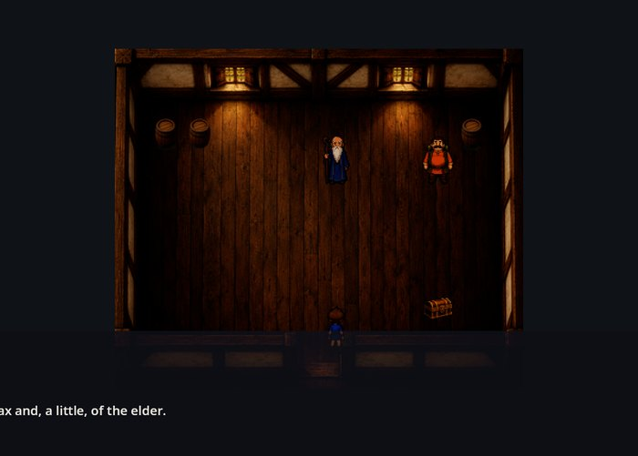

# RPG Map Editor — 绘制图块地图、摆放事件

RPG 地图编辑器在游戏运行时编辑 RPG 引擎的图块地图：三个图块图层、墙壁与通道、玩家出生点、随机战斗，以及事件——人物、告示牌、门、可拾取的物品。保存后地图立即在游戏中更新，按 **试玩** 就能走一走。

它从工具箱（工具栏上的锤子）打开，名为 **RPG 地图编辑器**，作用于玩家当前所在的地图。

## 一次编辑及其在游戏中的结果

RPG Plus 中长者之家编辑前的样子：

在编辑器里：**Appearance**（外观）标签页、商人的行走图、**Place NPC**（放置 NPC），再点一个空格子。新事件会在 **事件** 图层中被选中，属性显示在右侧：

**保存**（Ctrl+S）之后，商人就站进了屋里：

他的对话与行为在事件属性里设置：剧本、条件、触发方式。

## 图层与工具

- **背景层**、**主层**、**前景层** — 图块图层。背景层和主层可以用实心图块挡住去路；前景层画在角色之上，从不挡路。
- **碰撞** — 画在图块之上：*墙*（始终阻挡）、*通道*（始终可走）或 *自动*（取决于图块）。
- **事件** — 点击选中或拖动，双击空格子添加，Del 删除。
- **铅笔**、**橡皮**、**填充**；鼠标右键擦除，Alt+点击吸取图块，数字键 1–5 切换图层，B/E/G 切换画笔。
- **撤销**/**重做**（Ctrl+Z / Ctrl+Y）、网格、缩放（Ctrl+滚轮）。

左侧标签页：**瓦片**（地图图块集的调色板，整栋房子或整棵树这样的完整对象可以一次盖印）、**角色**（带战斗属性的角色，放置为敌人）、**物品**（放置为带数量的可拾取物）和 **Appearance**（已加载模组的全部行走图，放置为 NPC）。

右栏是地图属性：名称键、图块集、尺寸、缩放、固定环境光与氛围、出生点和朝向，以及随机战斗（约每 N 步一次，敌人组形如 `slime; wolf,slime`）。

## 俯视与等距

编辑器绘制地图的方式与游戏一致。工具栏上的视图切换器只改变预览；地图数据保持不变。等距预览中的房子：

游戏本身采用哪种视图由集合设置 `tile.renderer`（`topdown` 或 `isometric`）决定；加上 `--editor-renderer=isometric` 会直接以等距预览打开编辑器。

## 会写入哪些文件

- 地图本身保存到它自己的 `maps/<id>.json`。
- 事件写入同一模组中该地图自己的事件文件（`map_events/<地图>/…`）。其他文件或其他模组加进这张地图的事件会以虚线框半透明显示，永远不会被重写；它们的 id 不能重复使用。
- 文件列表旁的 **+** 在所选模组里新建地图；保存之后，游戏立刻把它当作场景。
- 只有以文件夹形式安装的模组才能写入。

## 如果遇到问题

1. **试玩提示游戏不认识该场景。** 地图需要在它的模组里有 `scenes/<id>.json`。
2. **事件选不中。** 它属于另一个文件或模组（虚线框）。
3. **NPC 不说话。** 它的事件没有剧本，或者触发方式不是动作键。
4. **保存改动了你没碰过的行。** 编辑器按自己的顺序写文件，还会补上事件的默认值，所以 diff 显示的内容可能多于这次编辑。
